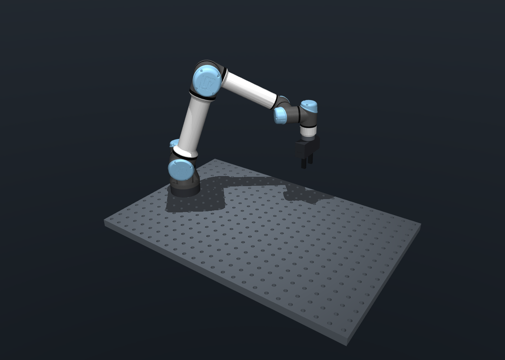

# Simulation Environments

Reusable MuJoCo scenes and robot assets for manipulation experiments.

| Experiment | Setup | Scene |
|---|---|---|
| [Exp 1](docs/setup_1.md) | UR5e, flange adapter, and WSG-50 on a perforated table |  |
| Exp 2 | | |

```bash
python3 scripts/view_scene.py
```
