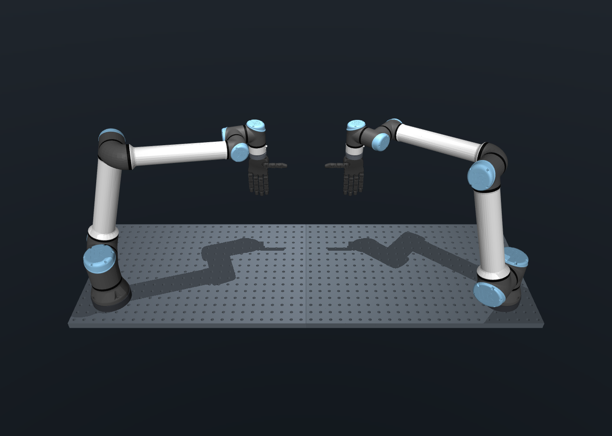

# Simulation Environments

Reusable MuJoCo scenes and robot assets for manipulation experiments.

| Experiment | Setup | Scene |
|---|---|---|
| [Exp 1](docs/setup_1.md) | UR5e, flange adapter, and WSG-50 on a Siegmund welding table |  |
| [Exp 2](docs/setup_2.md) | Exp 1 with custom WSG-50 fingers and dual GelSight Mini sensors |  |
| [Exp 3](docs/setup_3.md) | Dual UR10e with left/right HX5-D20 hands on two joined Siegmund welding tables |  |

```bash
python3 scripts/view_scene.py
python3 scripts/view_scene.py --setup 2
python3 scripts/view_scene.py --setup 3  # MuJoCo 3.13+
```
