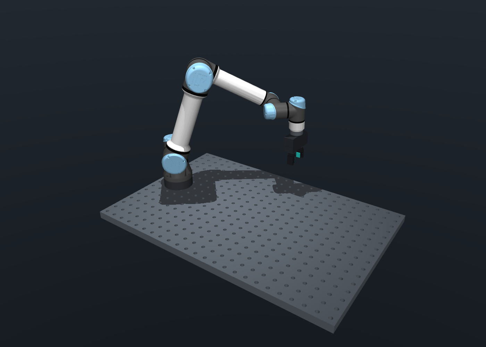
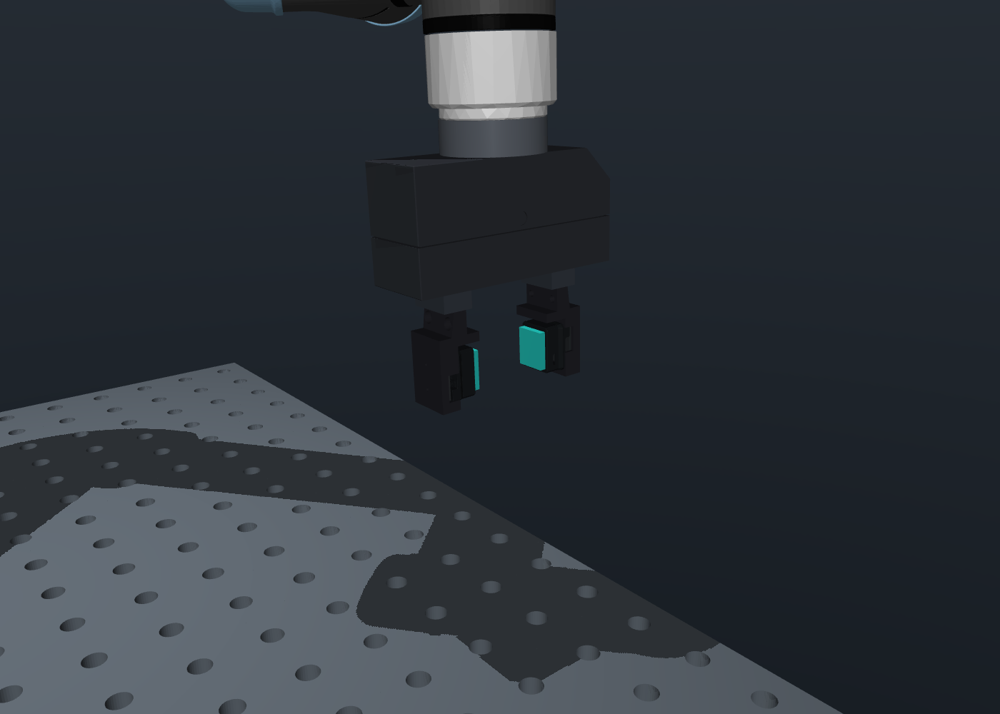

# Experimental Setup 2

Exp 1's **UR5e, 20 mm flange adapter, WSG-50, and Siegmund welding table** with
two short **`WSG50_GELSIGHT_fin.stl` fingers and GelSight Mini sensors** from
`diffpatch_ex`. The robot/table calibration and initial arm pose are unchanged.





```bash
python scripts/view_scene.py --setup 2
python scripts/view_scene.py --setup 2 --view tool
python scripts/view_scene.py --setup 2 --step
python scripts/build_exp2.py
python scripts/view_scene.py --setup 2 --render outputs/exp2.png --software
```

Edit [`configs/exp2.json`](../configs/exp2.json) for the sensor mounting,
opening-to-gap reference, assumed masses, and camera. Rebuild Exp 1 first if
[`configs/bench.json`](../configs/bench.json) changes. The scene is
[`models/exp2.xml`](../models/exp2.xml); resolved transforms and provenance of
the base calibration are recorded in
[`models/exp2_assembly.json`](../models/exp2_assembly.json).

The finger STL is interpreted in millimeters and registered to the sensor
using the short-pocket transform in `diffpatch_ex.mujoco_system`. The Mini case
and back cover meshes are already in meters. See the
[asset documentation](../assets/wsg50_gelsight/README.md) for sources and frames.

Both sensors face inward with zero tilt. The 14 mm carriage extension and
finger mating transform are inherited assembly assumptions; Exp 2 does not
import recording-specific camera corrections, sensor tilt, or fitted materials.
The nominal ready opening is 50 mm. Each slide coordinate is half the WSG
opening; the default also gives a 50 mm gel surface gap. That equality is
uncalibrated and can be changed using `reference_opening_m` and
`surface_gap_at_reference_m`. For parallel sensors:
`surface_gap = opening + surface_gap_at_reference − reference_opening`.

The scene has eight joints and eight actuators. `gelsight_left_surface` and
`gelsight_right_surface` mark the inward gel face centers; `tcp` is their nominal
midpoint, 147.5 mm along tool0 +z. The flange and WSG body are shared with Exp 1.

Gel dimensions are **4.25 × 20.75 × 25.25 mm**. Gel pads use rigid box geometry
with standard MuJoCo contact; the housing uses a box proxy and each finger uses
a convex collision hull. Bracket pockets and bolt holes are visual details in
this collision approximation. Masses, inertia, and contact parameters are
simulation assumptions. Optical tactile images and continuum gel deformation
are not modeled.

Validation covers unchanged Exp 1 base/flange transforms, CAD units and mating
planes, opposing sensor normals, gel gaps over the travel range, sphere contact
on both gel faces, dynamic opening/closing, source hashes, and relocation.
