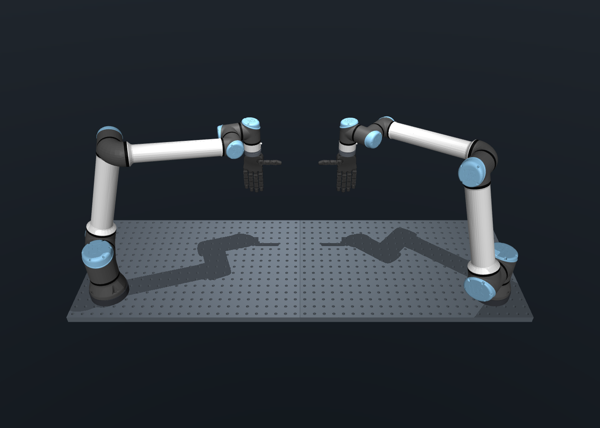
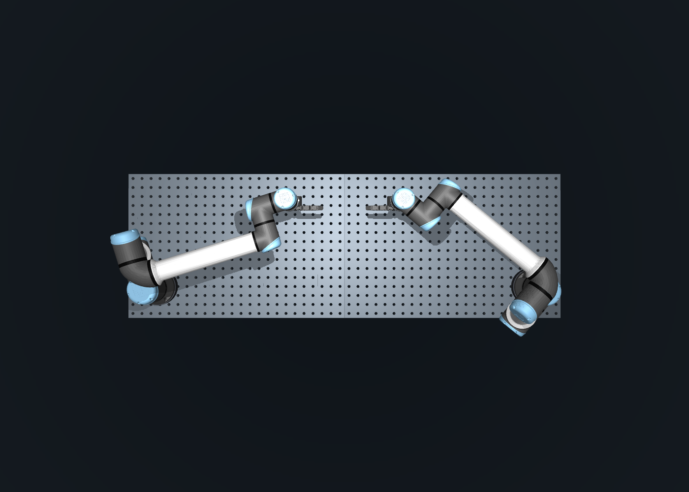

# Experimental Setup 3

Two joined **Siegmund welding tables**, with a **UR10e + ROBOTIS HX5-D20 left
hand** at the lower-left corner and a **UR10e + HX5-D20 right hand** at the
lower-right corner. The ready pose places both hands above the central workspace.



## View and rebuild

Use MuJoCo 3.13 or newer; the complete scene, rendering, and tests were validated
with MuJoCo 3.17.0. The upstream hand actuators cannot load in MuJoCo 3.1.5.
From the repository root, in an appropriate Python environment:

```bash
python -m pip install -e ".[exp3,test]"
python scripts/view_scene.py --setup 3
python scripts/view_scene.py --setup 3 --step
python scripts/build_exp3.py
python scripts/view_scene.py --setup 3 --render outputs/exp3.png --software
python -m pytest -q
```

The local interpreter used for validation and rendering was
`/home/haegu/diffpatch_ex/.venv/bin/python`. Scene files do not depend on that path.
Use `--view top` for the layout or `--view tool` for the hands.

## Layout

All positions below are in meters. World x points right, y points toward the
back, and z points up. The tabletop is z = 0; the lower/front edge is y = −0.8.

| Component | Position or extent |
|---|---|
| Left tabletop | x: 0–1.2, y: −0.8–0 |
| Right tabletop | x: 1.2–2.4, y: −0.8–0 |
| Left robot mount origin | [0.175, −0.625, 0.041] |
| Right robot mount origin | [2.225, −0.625, 0.041] |
| Left flange, ready pose | [0.95, −0.20, 0.64] |
| Right flange, ready pose | [1.45, −0.20, 0.64] |

Each 1.2 × 0.8 m table reuses Exp 1's 35 mm plate, 8 mm hole radius, 50 mm
hole pitch, and 25 mm edge offsets. The combined surface is 2.4 × 0.8 m with
768 polygonal through-holes and convex prism collision geometry. The plates
touch at x = 1.2; the seam marker is visual only.



## Assets and installation settings

- [`configs/exp3.json`](../configs/exp3.json): table origins, robot mounts,
  flange targets, hand orientation, adapters, and camera settings.
- [`models/exp3.xml`](../models/exp3.xml): portable scene with 52 joints and
  52 actuators (6 per arm and 20 per hand), plus a `ready` keyframe.
- [`models/exp3_assembly.json`](../models/exp3_assembly.json): configuration
  snapshot and solved ready joint angles.
- [`assets/ur10e/`](../assets/ur10e/README.md) and
  [`assets/robotis_hx5_d20/`](../assets/robotis_hx5_d20/README.md): retained
  upstream models, meshes, licenses, and provenance.

Installation poses are **nominal**, not measured Exp 3 calibration. Base
spacers are visual cylinders; each hand adapter is an approximate cylinder
with 45 mm radius and 20 mm thickness. The hand base is 20 mm along flange +z.
The UR10e flange marker uses the nominal wrist-3 y offset of 116.55 mm.
Mount yaw values (−90° left, +90° right) apply outside the source model's
90° base rotation. Exp 1's UR5e calibration is not applied here.

Edit the configuration and rebuild to match measured hardware later. If the
shared table dimensions change, rebuild Exp 1 with `scripts/build_scene.py`
before rebuilding Exp 3. Validation checks hand assignment, source arm forward
kinematics, all hole openings, collision clearance, a two-second dynamic hold,
source hashes, and loading after relocation.
