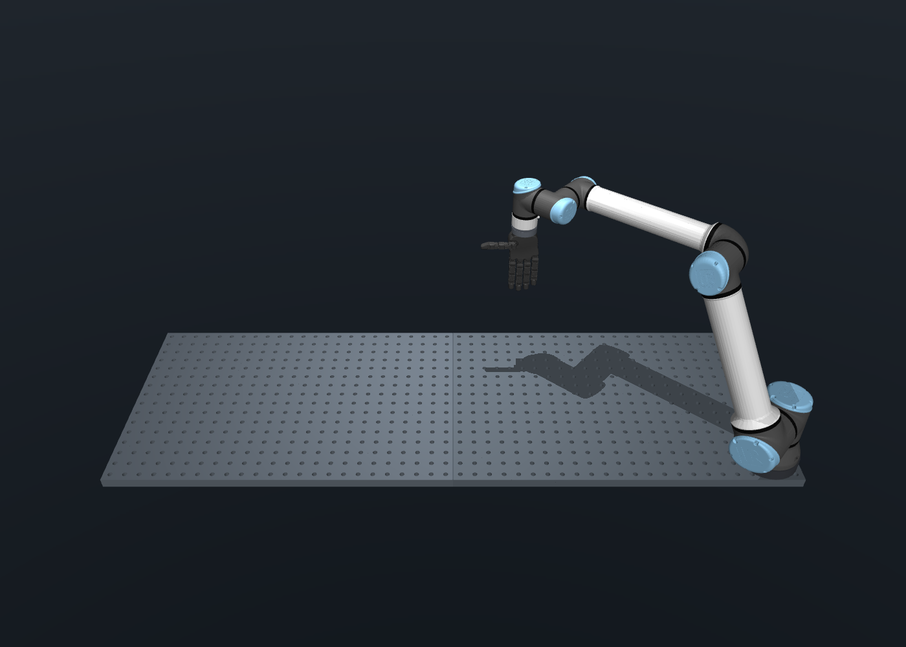

# Experimental Setup 4

Exp 3 with only the **right UR10e + ROBOTIS HX5-D20 right hand**. Both joined
Siegmund welding tables and the world coordinate frame are preserved. The right
robot base is at hole index (2.5, 2.5), counted from the front-right corner.
The ready joint angles are solved again to preserve the flange target pose.
The left arm, hand, mounts, and actuators are removed.



## View and rebuild

Use MuJoCo 3.13 or newer, as required by the upstream HX5-D20 actuators.
From the repository root:

```bash
python -m pip install -e ".[exp4,test]"
python scripts/view_scene.py --setup 4
python scripts/view_scene.py --setup 4 --step
python scripts/build_exp4.py
python scripts/view_scene.py --setup 4 --render outputs/exp4.png --software
python -m pytest -q tests/test_exp3.py tests/test_exp4.py
```

The existing local environment `/home/haegu/diffpatch_ex/.venv/bin/python`
provides MuJoCo 3.17.0. Use `--view top` for the table layout or `--view tool`
for a close-up of the right hand.

## Layout and assets

World x points right, y points toward the back, and z points up. The tabletop
is z = 0. All positions below are in meters.

| Component | Position or extent |
|---|---|
| Left tabletop | x: 0–1.2, y: −0.8–0 |
| Right tabletop | x: 1.2–2.4, y: −0.8–0 |
| Right robot mount origin | [2.30, −0.70, 0.041] |
| Right flange, ready pose | [1.45, −0.20, 0.64] |

For base placement, hole indices start at 1 and count inward from the right
table's **front-right corner**, along −x and +y. Index 2.5 is halfway between
the second and third holes. With a 25 mm edge offset and 50 mm hole pitch,
the base center is 100 mm from both edges. In the existing named hole-site
convention (counting from the back-left), this is fractional index (22.5, 14.5).
Base height remains 41 mm and mount yaw remains +90°.

The scene has **26 joints and 26 actuators**: six for the UR10e and twenty for
the HX5-D20 hand. Both tables retain their 768 combined through-holes.
Existing right-side joint, actuator, body, and site names are preserved.

- [`configs/exp4.json`](../configs/exp4.json): right robot, table, and camera settings.
- [`models/exp4.xml`](../models/exp4.xml): scene and `ready` keyframe.
- [`models/exp4_components/`](../models/exp4_components/): generated scene fragments.
- [`models/exp4_assembly.json`](../models/exp4_assembly.json): configuration and solved ready joint angles.

The builder shares assembly code with Exp 3 and writes its own scene fragments.
It reads the same upstream robot and hand assets and the generated Exp 1 table
template. If table dimensions change, run `scripts/build_scene.py` first.

The base position is set from the hole grid. Cylindrical mount approximations
are inherited from [Exp 3](setup_3.md); no measured base calibration is applied.
